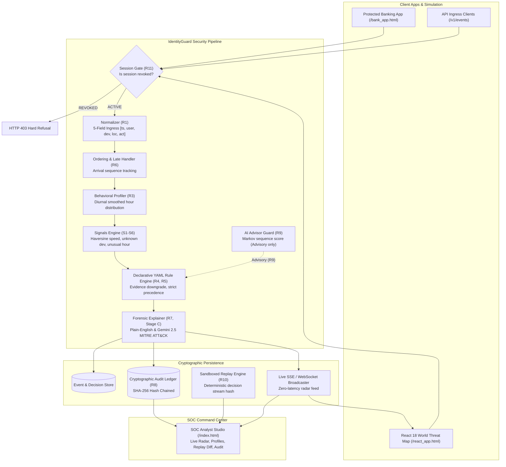

# IdentityGuard: Enterprise Session Risk & Account-Takeover Detection Engine

[](https://python.org)
[](https://fastapi.tiangolo.com)
[]()
[]()
[]()

> **Challenge A-03 | Domain 2: AI Systems & Infrastructure**  
> **Dr. D. Y. Patil Institute of Technology (Pimpri, Pune)**

IdentityGuard is a high-performance, deterministic cybersecurity engine designed to detect and terminate **Account Takeover (ATO)** attacks, **Session Hijacking**, and **Behavioral Anomalies** in real-time. It unifies declarative rule evaluation, continuous geodesic behavioral profiling, cryptographically chained audit ledgers, and sandboxed deterministic replay.

---

## 🏛️ System Architecture



---

## ⚡ Core Hackathon Invariants Matrix

| Invariant | Specification | Architectural Implementation |
|---|---|---|
| **R1: Strict 5-Field Ingress** | Accept strictly `[timestamp, user, device_id, location_label, action]`. | Normalizer validates 5 fields. Accepts missing devices or unresolvable locations with warnings. Rejects missing users. |
| **R2: Deterministic Signals** | Pure mathematical calculations with zero random jitter. | S1: Unknown device. S2: Haversine great-circle speed (>900 km/h). S3: Smoothed circular hour. S4: Sensitive post-login action. |
| **R3: Cold-Start Profiling** | Three-tier evidence confidence: `none`, `limited`, `sufficient`. | Cold-start sessions downgrade harsh automatic revocations to step-up verification or analyst queue to avoid false positives. |
| **R4 & R5: Declarative DSL & Precedence** | Human-readable rules with strict priority. | Fully readable `config/rules.yaml`. Precedence: `REVOKE` > `STEP_UP` > `ANALYST_REVIEW` > `NO_ACTION`. |
| **R6: Out-of-Order Resilience** | Resilient against network delays and clock skew. | Arrival sequence sorting with configurable lateness tolerances. |
| **R7: Plain-English Explanations** | Multi-layer explanations with zero technical jargon. | Clear plain-English summaries for SOC analysts and end users. |
| **R8: Tamper-Evident Ledger** | Cryptographically chained audit log. | SHA-256 hash chaining: $\text{hash}_n = \text{SHA-256}(\text{hash}_{n-1} \parallel \text{row})$. Runtime verification detects SQL row tampering. |
| **R9: AI Strictly Advisory** | AI cannot execute security actions alone. | Compile-time AST validator + runtime circuit breaker blocks ML signals from firing without deterministic support. |
| **R10: Sandboxed Deterministic Replay** | Replay must yield bit-exact decision stream hashes. | Sandboxed in-memory runner computes reproducible SHA-256 hash streams and candidate policy diff matrices. |
| **R11: Terminal Session Gate** | Once revoked, all subsequent actions are hard blocked. | Revocation returns HTTP 403 `SESSION_REVOKED`, halts execution, and prevents learning into user profile. |

---

## 🚀 1-Click Quickstart

### Prerequisites
- Python 3.11, 3.12, 3.13, or 3.14.
- No external databases or node.js/npm dependencies required at runtime.

### Launch Server
```powershell
python run.py
```

The launcher will initialize SQLite tables, pre-seed realistic multi-persona demonstration datasets (Asha, David, Elena), and spin up the server on `http://127.0.0.1:8000`.

### Direct Web Endpoints
- **SOC Analyst Command Center:** `http://127.0.0.1:8000/`
- **React 18 World Threat Map:** `http://127.0.0.1:8000/react_app.html`
- **Target Retail Banking App:** `http://127.0.0.1:8000/bank_app.html`
- **Interactive OpenAPI Documentation:** `http://127.0.0.1:8000/docs`

---

## 🧪 Comprehensive Automated Verification

Run the full acceptance and unit test suite (66/66 passing):

```powershell
python -m pytest tests/ -v
```

### Test Breakdown
- `tests/test_acceptance.py`: Codified acceptance tests verifying 100% compliance with R1 through R11.
- `tests/test_signals.py`: Geodesic Haversine speed, diurnal circular histogram, and edge cases.
- `tests/test_rules.py`: Declarative YAML evaluator, evidence downgrades, and strict precedence.
- `tests/test_ai_guard.py`: Markov chain advisor, AST compile-time validator, and runtime circuit breaker (R9).
- `tests/test_bridge_sync.py`: Dynamic policy slider synchronization and unified data pipeline.
- `tests/test_streaming.py`: Server-Sent Events (SSE) and WebSocket pub/sub live radar broadcast.
- `tests/test_gemini_forensics.py`: Google Gemini 2.5 LLM threat intelligence & offline MITRE ATT&CK generator.
- `tests/test_challenge_lifecycle.py`: Interactive 2FA challenge creation, OTP verification, and session recovery.
- `tests/test_replay.py`: Sandboxed replay isolation and deterministic SHA-256 stream hashes.

---

## 📖 Presentation Documentation
- **[120-Second Judge Walkthrough Script](docs/JUDGE_DEMO_WALKTHROUGH.md)**: Turnkey 2-minute demonstration plan for hackathon jury evaluation.
- **[Master Implementation Plan](docs/MASTER_IMPLEMENTATION_PLAN.md)**: Sequential engineering roadmap across Stages A through E.
- **[Architecture & Execution Plan PDF](docs/IdentityGuard_Architecture_and_Execution_Plan.pdf)**: Complete 12-page publication-grade PDF report.

---

## 🛡️ License
Built for VORTEXA 3.0 Hackathon. Apache 2.0 License.
