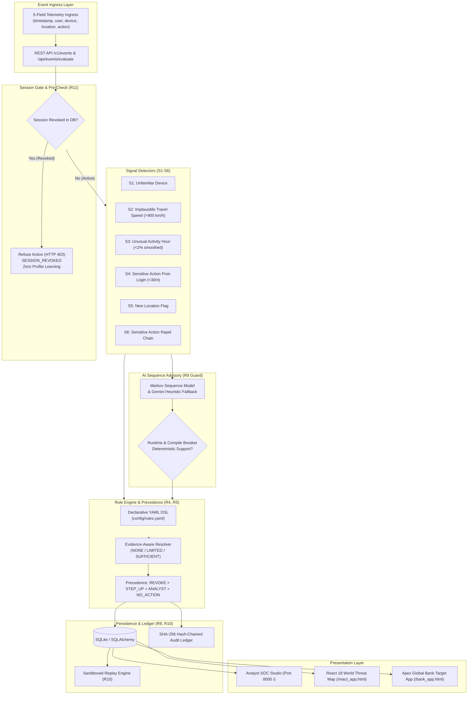
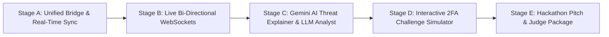

# IdentityGuard (A-03): Unified Implementation Plan & Hackathon Blueprint
**Domain 2: AI Systems & Infrastructure | Problem Statement Code: A-03**  
**Project Codebase:** `d:\Vortex 3.0`  
**Current Git Commit:** `911729d` | **Automated Tests Passing:** `53/53` (100%)

---

## 1. Executive Summary & Current Architecture State

Following the successful merging of the external `DY patil - 2 (CounterStrike)` module, **IdentityGuard** stands as a dual-layer cybersecurity and session risk intelligence platform:

1. **Enterprise Core Engine (Production Tier)**:
   - Strict 5-field event ingress: `[timestamp, user, device_id, location_label, action]`.
   - Continuous mathematical profiling (24-hour circular smoothed diurnal curve, device trust progression, geodesic Haversine speed detector).
   - Human-readable declarative YAML rules engine (`config/rules.yaml`) with evidence-aware fallback hierarchy (NONE $\to$ LIMITED $\to$ SUFFICIENT).
   - Markov sequence pattern advisor guarded by AST compile-time and runtime circuit breakers (**R9 invariant**: AI strictly advisory).
   - Persistent transactional state machine (SQLite/SQLAlchemy) with cryptographically hash-chained audit ledger (**R8**).
   - Sandboxed Replay Engine (**R10**) with bit-exact SHA-256 result stream hashing and delta comparison.
   - Terminal session gate (**R11**): any subsequent action on a revoked session is hard-refused with HTTP 403 `SESSION_REVOKED` and blocked from profile learning.

2. **Merged Threat Map & Scenarios Tier (`external_compat/`)**:
   - React 18 + Vite 5 + Tailwind CSS interactive frontend with **Geographic World Threat Map** (`react_app.html`).
   - Dynamic threshold configuration sliders (`/api/policy`).
   - 4 pre-packaged interactive judge scenarios (`SCENARIO_ATO_CHAIN`, `SCENARIO_IMPOSSIBLE_TRAVEL`, `SCENARIO_COLD_START`, `SCENARIO_OUT_OF_ORDER`).

---

## 2. Inventory: What Is Already Available in the System

| Subsystem | File Location | Status | Key Capabilities |
|---|---|---|---|
| **Event Contracts** | `core/contracts.py` | **Complete** | Pydantic V2 schemas: 5-field raw input, signals, advisory, decisions, evidence levels. |
| **Normalizer** | `core/normalize.py` | **Complete** | Geodetic Haversine, alias resolver, ISO 8601 UTC parser, out-of-order warning. |
| **Profile Manager** | `core/profile.py` | **Complete** | 24-hr circular smoothed histogram $P(h)$, device trust counter (3 logins), cold start levels. |
| **Signals Suite** | `core/signals/` | **Complete** | S1 (device), S2 (speed >900 km/h), S3 (hour <2%), S4 (sensitive post-login), S5, S6. |
| **AI Advisor & Guard** | `core/advisory/` | **Complete** | AST compile-time validator & runtime circuit breaker enforcing R9. |
| **YAML Rule Engine** | `core/rules/` | **Complete** | Declarative YAML DSL evaluator with evidence downgrades and strict precedence. |
| **Plain-English Explanations** | `core/explain/` | **Complete** | Multi-tier explanations for SOC analysts and end users without technical jargon. |
| **Storage & Ledger** | `store/` | **Complete** | Append-only event store, decision tables, cryptographic SHA-256 chained audit log. |
| **Pipeline Coordinator** | `core/pipeline.py` | **Complete** | End-to-end execution of session gate, signals, AI guard, rules, persistence, profile updates. |
| **API Endpoints** | `api/` | **Complete** | `/v1/events`, `/v1/sessions`, `/api/decisions`, `/api/replay`, `/api/audit`, `/api/quality`. |
| **Replay Engine (R10)** | `replay/` | **Complete** | Sandboxed in-memory re-execution with deterministic SHA-256 stream hash and diffing. |
| **Master Acceptance Suite** | `tests/test_acceptance.py` | **Complete** | Codified test suite proving 100% compliance with R1 through R11. |
| **External Compat Module** | `external_compat/` | **Complete** | Merged detector, scenarios (`SCENARIO_ATO_CHAIN`), and `/api/policy` dynamic sliders. |
| **Frontends** | `dashboard/static/` | **Complete** | Glassmorphic Analyst Studio (`index.html`), React World Threat Map (`react_app.html`), Banking Target App (`bank_app.html`). |

---

## 3. Sequential Stage-by-Stage Implementation Plan

Now that the core and external components are unified and pass 53/53 tests, the remaining work is divided into 5 structured stages to transform this project into an unbeatable hackathon submission.

---

### Stage A: Unified Data Bridge & Telemetry Alignment
**Goal:** Consolidate the two engine pipelines so that events submitted via the React UI or Banking App feed the same underlying database, audit ledger, and profile state.

- [ ] **A.1: Unify Event Ingestion Pipeline**
  - Modify `api/routes_compat.py` so that `POST /api/events/evaluate` translates `SecurityEvent` directly into `RawEventInput` and invokes the production `SecurityPipeline`.
  - Ensure decisions made via the React UI immediately appear in the Analyst SOC table (`/api/decisions`) and update the SHA-256 audit log.
- [ ] **A.2: Synchronize Scenario Replay with Replay Engine (R10)**
  - Connect `POST /api/scenarios/replay` to `ReplayRunner.run_replay()` so that pre-packaged scenarios compute deterministic SHA-256 stream hashes and display diff results.
- [ ] **A.3: Unified Policy Sync**
  - Connect `POST /api/policy` to dynamically update in-memory rule engine parameters (e.g. speed thresholds in `config/rules.yaml`).
- [ ] **A.4: Automated Test Verification**
  - Write `tests/test_bridge_sync.py` verifying that events sent to `/api/events/evaluate` reflect in `/api/decisions`.
- [ ] **Git Commit Milestone**: `feat(bridge): unify compat endpoints with enterprise pipeline and audit ledger`

---

### Stage B: Real-Time Streaming & Live Attack Radar (WebSockets / SSE)
**Goal:** Provide zero-latency live streaming so that when an attacker triggers an event in the banking app, the SOC dashboard and React Threat Map light up instantly without manual page refreshes.

- [ ] **B.1: Server-Sent Events (SSE) / WebSocket Feed**
  - Implement `GET /api/stream/events` endpoint in `api/routes_analyst.py` using FastAPI `EventSourceResponse` or native WebSockets.
  - Broadcast new decisions, signal activations, and session revocations in real-time.
- [ ] **B.2: Frontend Live Feed Hook**
  - Connect `dashboard/static/index.html` to the SSE stream: new decisions prepend to the table with flashing glow indicators.
  - Update top metric ribbon (Total Events, Revocations, Step-Ups) in real-time.
- [ ] **B.3: React Threat Map Live Pulse**
  - Add WebSocket/SSE listener to `react_app.html` to animate coordinate attack vectors across the world map.
- [ ] **Git Commit Milestone**: `feat(stream): real-time SSE event broadcast and live SOC visual radar`

---

### Stage C: Google Gemini 2.5 LLM Threat Intelligence & Forensic Explainer
**Goal:** Supercharge the SOC analyst experience by offering on-demand deep forensic threat analysis generated by Gemini 2.5 Flash, with offline heuristic fallback.

- [ ] **C.1: Gemini Client & Prompt Engineering**
  - Create `core/explain/gemini_forensics.py`:
    - Structured prompt taking event telemetry, historical baseline distribution, fired rules, and Markov sequence anomaly score.
    - Generates executive SOC summary: Threat vector hypothesis, MITRE ATT&CK mapping (T1566, T1078, T1539), and recommended analyst remediation steps.
- [ ] **C.2: Offline Venue Fallback Resilience**
  - Ensure zero runtime failures if `GEMINI_API_KEY` is absent or the venue network drops: graceful fallback to the local deterministic template generator (`core/explain/templates.py`).
- [ ] **C.3: Forensic Drilldown Modal in UI**
  - Add "Generate AI Forensic Report" button in the SOC inspection modal.
  - Display MITRE ATT&CK tags and tactical threat narrative.
- [ ] **Git Commit Milestone**: `feat(ai): Gemini 2.5 Flash threat intelligence and MITRE ATT&CK forensic generator`

---

### Stage D: End-to-End Step-Up 2FA Challenge & Session Recovery Simulator
**Goal:** Demonstrate the complete lifecycle of a high-risk event: `step_up` trigger $\to$ user receives 2FA challenge $\to$ user enters OTP $\to$ session state updates from `pending_verification` to `active` (or terminates on failed OTP).

- [ ] **D.1: Step-Up Challenge Lifecycle Router**
  - Enhance `api/routes_sessions.py`:
    - `POST /v1/sessions/{id}/challenge`: generates OTP challenge with expiration timer.
    - `POST /v1/sessions/{id}/verify-otp`: validates OTP, transitions session state, and logs cryptographic audit entry.
- [ ] **D.2: Target Banking App 2FA Modal**
  - In `dashboard/static/bank_app.html`, when `step_up` is returned:
    - Display interactive 2FA modal asking for a 6-digit verification code.
    - On valid OTP submission, re-attempt the blocked banking transaction seamlessly.
    - On invalid OTP submission (3 attempts), trigger hard session revocation.
- [ ] **D.3: Automated Test Verification**
  - Write `tests/test_challenge_lifecycle.py` verifying full 2FA resolution cycle.
- [ ] **Git Commit Milestone**: `feat(auth): interactive step-up 2FA challenge workflow and live recovery simulator`

---

### Stage E: Hackathon Pitch Kit & 1-Click Offline Packaging
**Goal:** Finalize all presentation assets, jury demonstration walkthroughs, and documentation to guarantee a winning hackathon presentation.

- [ ] **E.1: 2-Minute Judge Walkthrough Script (`docs/JUDGE_DEMO_WALKTHROUGH.md`)**
  - Step-by-step 120-second script for jury demonstration:
    1. Show normal user activity (Asha / Alice).
    2. Trigger midnight account takeover from unfamiliar device in target app.
    3. Watch live terminal revocation & 403 lockout.
    4. Switch to SOC Studio: show plain-English explanation, diurnal curve, and SHA-256 audit chain.
    5. Switch to React Threat Map: show intercontinental attack vector.
    6. Switch to Replay Sandbox: demonstrate R10 determinism and candidate policy diffing.
- [ ] **E.2: Updated Architecture PDF Generation**
  - Update `docs/generate_plan_pdf.py` to include the merged React Threat Map and new architecture diagram in the PDF report.
- [ ] **E.3: Final Repository Polishing**
  - Update root `README.md` with badges, architecture diagrams, video demo links, and simple quick-start commands.
- [ ] **Git Commit Milestone**: `docs: complete hackathon pitch kit, judge demonstration script & master guide`

---

## 4. Execution Matrix & Timeline

| Stage | Estimated Time | Key Deliverable | Verification Check |
|---|---|---|---|
| **Stage A** | 45 mins | Unified Pipeline Bridge | Tests verifying compat endpoints feed primary DB & audit log |
| **Stage B** | 30 mins | Real-Time SSE Event Streaming | Live flashing updates in SOC without page reload |
| **Stage C** | 30 mins | Gemini 2.5 Flash MITRE Threat Explainer | Deep forensic report generation with offline fallback |
| **Stage D** | 35 mins | Live Interactive 2FA Modal | Complete step-up $\to$ OTP $\to$ active session lifecycle in bank app |
| **Stage E** | 20 mins | Hackathon Presentation Pitch Kit | Polished README, judge script, updated PDF report |
